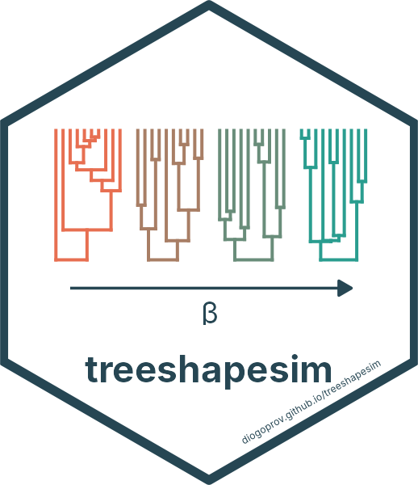

# treeshapesim 

<!-- badges: start -->
[](https://diogoprov.r-universe.dev/treeshapesim)
[](https://diogoprov.github.io/treeshapesim/)
[](https://github.com/diogoprov/treeshapesim/actions/workflows/R-CMD-check.yaml)
[](https://doi.org/10.5281/zenodo.23647260)
<!-- badges: end -->

Simulate rooted, binary, ultrametric trees in which topological imbalance and
the distribution of branching times are set by separate parameters.

- **Topology:** Aldous' (1996) beta-splitting model. `beta = 0` gives Yule
  trees, lower values give more imbalanced trees and higher values more
  balanced ones.
- **Branching times:** a pure-birth process in which each of the k lineages
  splits at rate k^c. `c = 0` is Yule, `c < 0` slows diversification towards
  the present (negative gamma; Pybus & Harvey, 2000) and `c > 0` speeds it up.

The gamma statistic depends only on the internode intervals and the Colless
index only on the topology, so `beta` mainly moves the Colless index and `c`
mainly moves gamma.

Documentation: <https://diogoprov.github.io/treeshapesim/>

## Installation

```r
install.packages("treeshapesim", repos = c("https://diogoprov.r-universe.dev",
                                           "https://cloud.r-project.org"))
# or
remotes::install_github("diogoprov/treeshapesim")
```

## Example

```r
library(treeshapesim)
set.seed(1)
tr <- sim_tree_shape(100, beta = -1, c = -0.5)   # imbalanced, early splits
tree_shape(tr)                                    # gamma and normalized Colless

# trees near target values of gamma and Colless
cal <- calibrate_shape(100)                       # calibration for 100 tips
trees <- sim_tree_target(100, gamma = -2, colless = 1, nsim = 50, tol = 0.25,
                         calibration = cal)

# a 3 x 3 grid of tree shapes and the parameters of each cell
grid <- shape_grid(100, gamma = c(-2, -1, 0), colless = c(0, 0.5, 1),
                   calibration = cal)

# any other dependence of the split rate on the number of lineages
tr <- sim_tree_shape(100, rate = function(k) 1 - k / 110)   # logistic
```

See `vignette("treeshapesim")` for a walk-through. Many other tree statistics
can be computed with [treestats](https://github.com/thijsjanzen/treestats).

## Use with comdynamite

treeshapesim produces the regional species pools of
[comdynamite](https://github.com/diogoprov/comdynamite), which simulates
process-based metacommunities with phylogenetic structure. The two packages
split the work: treeshapesim sets the shape of the tree, and comdynamite takes
that tree as a fixed input, places traits on it with a chosen phylogenetic signal
and runs the community dynamics. Any `phylo` object from `sim_tree_shape()` or
`sim_tree_target()` can be passed directly as the `species` argument of
comdynamite, so tree shape, phylogenetic signal and dispersal can be varied as
separate factors in a simulation study. Neither package depends on the other.

```r
# remotes::install_github("diogoprov/comdynamite")
library(comdynamite)
set.seed(1)
pool <- sim_tree_shape(40, beta = -1, c = -0.5)    # imbalanced, early splits
sim <- simulate_metacommunity(
  landscape = landscape_implicit(20),
  traits    = species_traits(pool, lambda = 1),
  alpha     = competition_matrix(pool, type = "phylo"),
  dispersal = 0.01,
  n_steps   = 1000
)
sim$abundance                                      # sites x species
```

To replicate across shapes, `shape_grid()` gives `beta` and `c` for each
combination of gamma and Colless, and `sim_tree_target()` draws the pools of each
cell.

## How treeshapesim differs from TreeSim and apTreeshape

| | treeshapesim | TreeSim | apTreeshape |
|---|---|---|---|
| Purpose | Trees whose imbalance and distribution of branching times vary independently, for simulation studies on tree shape | Trees from birth–death processes | Analysis and simulation of tree topologies |
| Topology | Aldous' beta-splitting model, with `beta` as a continuous parameter | Not a parameter: it follows from the birth–death process | Yule, PDA, Aldous' branching, biased and user-defined split models (`rtreeshape()`); beta-splitting with a clade age–richness index (`simulate_tree()`, `simulate_yule()`) |
| Branching times | Pure birth with per-lineage rate k^c or any function of k (`rate`), drawn independently of the topology, so gamma can be negative, near zero or positive | Birth–death with constant rates, rate shifts, mass extinctions or density-dependent speciation, conditioned on the number of tips and/or the age | None (`rtreeshape()`), ranks 1 to n − 1 (`simulate_tree()`) or a constant-rate birth–death process (`simulate_yule()`) |
| Separate control of imbalance and branching times | Yes: the realized gamma depends only on `c` and the realized Colless index only on `beta` | No: imbalance is not set | Imbalance is set by `beta`; branching times have no shape parameter of their own |
| Target values of gamma and Colless | Yes: calibration, rejection to a tolerance and grids of shapes (`sim_tree_target()`, `shape_grid()`) | No | No |
| Extinction, serial sampling, gene trees | No (pure birth), but random incomplete sampling of tips (`sampling_fraction`) | Yes | Extinction in the ranked-tree models |
| Estimation and tests of tree shape | No | No | Yes (e.g. `maxlik.betasplit()`, `aldous.test()`) |

Use TreeSim for trees from specific birth–death models and apTreeshape to model,
estimate or test topological imbalance. Use treeshapesim when the imbalance and
the distribution of branching times have to be varied as separate factors. The
comparison is based on the documentation of TreeSim 2.4 and apTreeshape 1.5-0.1;
apTreeshape was archived on CRAN in 2023 and is available from the CRAN archive.

## Citation

Provete, D. B. (2026). treeshapesim: Simulate trees with separately controlled
imbalance and branching times. R package. https://doi.org/10.5281/zenodo.23647260

This DOI always points to the latest version; each release also has its own DOI
on Zenodo. In R, `citation("treeshapesim")` gives the entry with the installed
version.

## References

Aldous, D. (1996). Probability distributions on cladograms. In D. Aldous &
R. Pemantle (Eds.), *Random discrete structures* (pp. 1–18). Springer.
https://doi.org/10.1007/978-1-4612-0719-1_1

Pybus, O. G., & Harvey, P. H. (2000). Testing macro-evolutionary models using
incomplete molecular phylogenies. *Proceedings of the Royal Society B*, 267,
2267–2272. https://doi.org/10.1098/rspb.2000.1278
