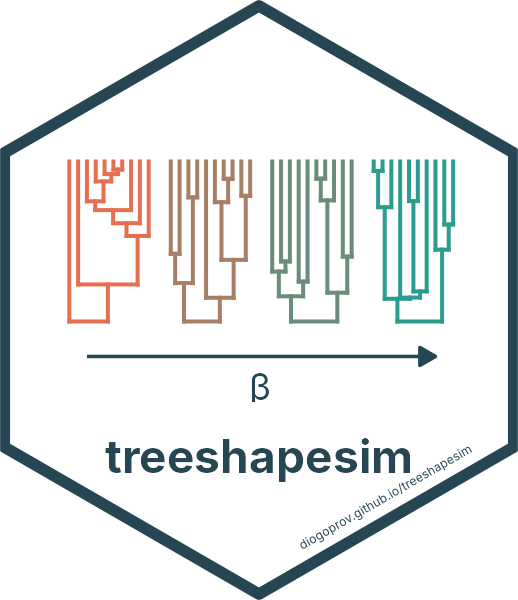

# treeshapesim 

<!-- badges: start -->
[](https://diogoprov.r-universe.dev/treeshapesim)
[](https://diogoprov.github.io/treeshapesim/)
<!-- badges: end -->

Simulate rooted, binary, ultrametric trees in which topological imbalance and
the distribution of branching times are set by separate parameters.

- **Topology:** Aldous' (1996) beta-splitting model. `beta = 0` gives Yule
  trees, lower values give more imbalanced trees and higher values more
  balanced ones.
- **Branching times:** a pure-birth process in which each of the k lineages
  splits at rate k^c. `c = 0` is Yule, `c < 0` slows diversification towards
  the present (negative gamma; Pybus & Harvey, 2000) and `c > 0` speeds it up.

The gamma statistic depends only on the internode intervals and the Colless
index only on the topology, so `beta` mainly moves the Colless index and `c`
mainly moves gamma.

Documentation: <https://diogoprov.github.io/treeshapesim/>

## Installation

```r
install.packages("treeshapesim", repos = c("https://diogoprov.r-universe.dev",
                                           "https://cloud.r-project.org"))
# or
remotes::install_github("diogoprov/treeshapesim")
```

## Example

```r
library(treeshapesim)
set.seed(1)
tr <- sim_tree_shape(100, beta = -1, c = -0.5)   # imbalanced, early splits
ape::gammaStat(tr)

# a 3 x 3 grid of tree shapes, 100 trees per cell
grid <- expand.grid(beta = c(-1.5, -0.75, 0), c = c(-1, -0.5, 0))
trees <- lapply(seq_len(nrow(grid)), function(i)
  replicate(100, sim_tree_shape(100, grid$beta[i], grid$c[i]), simplify = FALSE))
```

The tree statistics themselves (gamma, Colless and many others) can be computed
with [treestats](https://github.com/thijsjanzen/treestats).

## References

Aldous, D. (1996). Probability distributions on cladograms. In D. Aldous &
R. Pemantle (Eds.), *Random discrete structures* (pp. 1–18). Springer.
https://doi.org/10.1007/978-1-4612-0719-1_1

Pybus, O. G., & Harvey, P. H. (2000). Testing macro-evolutionary models using
incomplete molecular phylogenies. *Proceedings of the Royal Society B*, 267,
2267–2272. https://doi.org/10.1098/rspb.2000.1278
